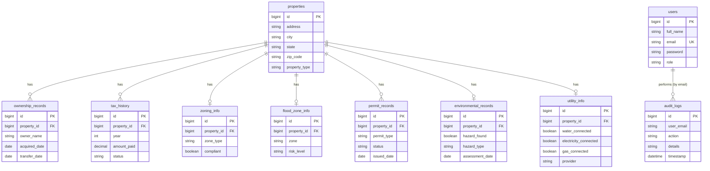

# Real Estate Due Diligence Agent

Infosys Springboard internship project (Team Two). A buyer enters a property address; the platform validates it, gathers ownership, tax, zoning, flood, permit, environmental and utility data, calculates a risk score, and produces a PDF/Excel report.

- **Live app:** <vercel url>
- **API docs (Swagger):** <render url>/swagger-ui.html
- **Postman collection:** `docs/postman/`

## Tech stack

Java, Spring Boot, Spring Security (JWT, role-based access), Spring Data JPA, PostgreSQL (Neon), React/Next.js (Vercel), Docker (Render), JUnit 5 + Mockito.

## Features

Registration/login with JWT and 5 roles; address validation (Geoapify); property search and creation; 7 due-diligence modules; risk assessment; comparable properties; PDF and Excel reports; email notification; audit log; admin dashboard.

## Architecture

React frontend -> Spring Boot REST API (controller -> service -> repository) -> PostgreSQL.
External: Geoapify (address validation), Gmail SMTP (email). Ownership, tax, zoning, flood and permit data is **simulated**, because real registry APIs aren't available to students.

## ER diagram

## Run locally

1. Install Java, Maven, PostgreSQL; create a database `duediligence_db`.
2. Set environment variables: `DB_PASSWORD`, `JWT_SECRET` (32+ chars), `GEOAPIFY_API_KEY`, `MAIL_USERNAME`, `MAIL_APP_PASSWORD`.
3. Backend: `cd backend && ./mvnw spring-boot:run` (http://localhost:8080).
4. Frontend: `cd frontend && npm install && npm run dev` (http://localhost:3000).
5. Tests: `cd backend && ./mvnw test`.

## Deployment

Neon (database), Render (backend Docker image), Vercel (frontend). Config is by environment variables: `DB_URL`, `DB_USERNAME`, `DB_PASSWORD`, `JWT_SECRET`, `GEOAPIFY_API_KEY`, `MAIL_*`, `CORS_ALLOWED_ORIGINS`, `NEXT_PUBLIC_API_BASE_URL`.

## Known limitations

Simulated registry data; free hosting sleeps when idle; JWT has no refresh or revocation.

## Team

Backend: <your name>. Frontend and database: <teammates>.
