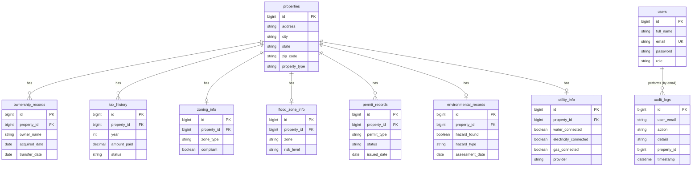

# Real Estate Due Diligence Agent

*Autonomous Property Research and Real Estate Risk Assessment Intelligence System*

Infosys Springboard Virtual Internship project (Team Two). A user enters a property address. The platform validates it, gathers ownership, tax, zoning, flood, permit, environmental and utility information, calculates a risk score, and produces a downloadable PDF or Excel report.

> The backend is on a free host and sleeps after about 15 idle minutes. The first request can take 30 to 50 seconds. Open `<your-render-url>/api/health` a minute before using the app.

---

## Table of contents

1. [Problem and solution](#problem-and-solution)
2. [Features](#features)
3. [Tech stack](#tech-stack)
4. [Architecture](#architecture)
5. [Repository structure](#repository-structure)
6. [API reference](#api-reference)
7. [Security design](#security-design)
8. [Risk scoring](#risk-scoring)
9. [Database](#database)
10. [Configuration](#configuration)
11. [Run locally](#run-locally)
12. [Testing](#testing)
13. [Deployment](#deployment)
14. [Simulated data and limitations](#simulated-data-and-limitations)
15. [Milestones](#milestones)
16. [Team](#team)

---

## Problem and solution

Buying property is a large financial decision, but checking it properly means visiting several offices (land registry, tax authority, zoning board, flood and permit offices) and reading many documents. That is slow and easy to get wrong.

This platform brings those checks into one place. Given an address, it returns the due-diligence data for the property, a single risk score (LOW, MEDIUM or HIGH) with a reason for each factor, and a report that can be downloaded and shared.

Intended users: buyers, real estate agents, legal reviewers, financial institutions, and administrators.

## Features

- **Authentication and roles:** registration and login with JWT, BCrypt password hashing, five roles (BUYER, REAL_ESTATE_AGENT, LEGAL_REVIEWER, FINANCIAL_INSTITUTION, ADMINISTRATOR), and role-based access control.
- **Address validation:** real geocoding through Geoapify, called from the backend so the API key never reaches the browser.
- **Property search and creation:** search saved properties by partial address; create a property from a validated address, with duplicate prevention.
- **Seven due-diligence modules:** ownership history, tax history, zoning, flood zone, permits, environmental records, utilities, all returned by one endpoint.
- **Risk assessment:** weighted score with an explanation for each factor.
- **Comparable properties:** nearby listings with price and distance.
- **Reports:** PDF and Excel export.
- **Notifications:** an email when a report is ready.
- **Audit logging:** records logins, registrations, property creation and report downloads.
- **Admin tools:** platform statistics, audit log and user list.
- **Reliability:** retry logic with a clean 503 response when a data source fails.
- **Input validation** with consistent JSON error responses.

## Tech stack

| Layer | Technology |
|---|---|
| Backend | Java 21+, Spring Boot 4.1, Spring MVC, Spring Security, Spring Data JPA (Hibernate), Maven |
| Authentication | JWT (jjwt), BCrypt |
| Database | PostgreSQL (Neon in production) |
| Reports | OpenPDF (PDF), Apache POI (Excel) |
| Email | Spring Mail with Gmail SMTP |
| API docs | springdoc OpenAPI, Swagger UI |
| Testing | JUnit 5, Mockito, Spring MockMvc |
| Frontend | React / Next.js, Tailwind CSS |
| Containers and hosting | Docker (backend image), Render (backend), Vercel (frontend), Neon (database) |

## Architecture

```
React / Next.js frontend  ->  Spring Boot REST API  ->  PostgreSQL
        (Vercel)                   (Render)                (Neon)
                                      |
                                      +--> Geoapify         (address validation, real)
                                      +--> Gmail SMTP       (report email, real)
                                      +--> Simulated registry service
                                           (ownership, tax, zoning, flood, permits, ...)
```

The backend is a layered monolith:

```
Request -> JwtAuthFilter -> Controller -> Service -> Repository -> PostgreSQL
                                |
                      GlobalExceptionHandler  (errors -> clean JSON)
```

- **Controller:** receives HTTP, validates input, returns JSON.
- **Service:** business rules (risk scoring, aggregation, retries, reports).
- **Repository:** Spring Data JPA interfaces.
- **Entity and DTO:** entities map to tables; DTOs define what the API accepts and returns, so internal fields such as password hashes never leave the server.

## Repository structure

```
.
├── backend/                 Spring Boot application
│   ├── Dockerfile
│   ├── pom.xml
│   └── src/main/java/com/realestate/duediligence/
│       ├── config/          SecurityConfig, OpenApiConfig, AppConfig
│       ├── controller/      Auth, Property, Admin, Health (and user dashboard)
│       ├── dto/             request and response objects
│       ├── entity/          JPA entities and enums
│       ├── exception/       GlobalExceptionHandler, ExternalServiceException
│       ├── repository/      Spring Data repositories
│       ├── security/        JwtUtil, JwtAuthFilter
│       └── service/         business logic
├── frontend/                React / Next.js application
├── database/                SQL scripts (indexes, seed data)
├── docs/                    API contract, openapi.json, Postman collection, ER diagram
└── README.md
```

## API reference

Interactive documentation: `/swagger-ui.html`. Raw OpenAPI spec: `/v3/api-docs` (a snapshot is in `docs/openapi.json`).

**Public**

| Method | Endpoint | Description |
|---|---|---|
| POST | `/api/auth/register` | Create an account (ADMINISTRATOR cannot be self-registered) |
| POST | `/api/auth/login` | Returns a JWT and user details |
| GET | `/api/health` | Health check, `{"status":"UP"}` |

**Authenticated (any role)** — send `Authorization: Bearer <token>`

| Method | Endpoint | Description |
|---|---|---|
| GET | `/api/properties/search?address=` | Case-insensitive partial address search |
| POST | `/api/properties/validate-address` | Validate an address with Geoapify |
| POST | `/api/properties` | Validate and save a new property |
| GET | `/api/properties/{id}` | All due-diligence sections for one property |
| GET | `/api/properties/{id}/risk-assessment` | Score, level and explanatory notes |
| GET | `/api/properties/{id}/comparables` | Three nearby comparable properties |
| GET | `/api/properties/{id}/report/pdf` | Download the PDF report |
| GET | `/api/properties/{id}/report/excel` | Download the Excel report |
| GET | `/api/me/dashboard` | The signed-in user's own recent properties and report history |

**Administrator only**

| Method | Endpoint | Description |
|---|---|---|
| GET | `/api/admin/dashboard` | Totals, risk-level distribution, report count |
| GET | `/api/admin/audit-logs` | All audit entries, newest first |
| GET | `/api/admin/users` | All users (never includes password hashes) |
| GET | `/api/properties/admin-check` | Role-check test endpoint |

**Error format** — every error uses the same shape:

```json
{ "success": false, "error": { "code": "VALIDATION_ERROR", "message": "password: Password must be 8 to 72 characters" } }
```

| Status | Meaning |
|---|---|
| 200 / 201 | Success / created |
| 400 | Invalid input, unknown property, duplicate email or address |
| 401 | Missing, expired or invalid token |
| 403 | Authenticated, but the role is not allowed |
| 503 | An external data source failed after retries |
| 500 | Unexpected error (details are logged, not returned) |

## Security design

1. **Login:** the password is checked with BCrypt, then a JWT is created containing the email and role, signed with a secret key (24-hour expiry).
2. **Every request:** `JwtAuthFilter` verifies the signature and expiry and marks the request authenticated with the authority `ROLE_<role>`.
3. **Rules:** `/api/auth/**`, `/api/health`, `/error` and the API docs are public; everything else requires authentication. Admin endpoints use `@PreAuthorize("hasRole('ADMINISTRATOR')")`.
4. **Responses:** no token or a bad token gives 401; a valid token with the wrong role gives 403.
5. **Admin accounts** cannot be self-registered. The backend rejects it, because a hidden dropdown is not a security control.
6. **Stateless:** no server sessions, so CSRF protection is off (the token is sent in a header, not a cookie).
7. **Secrets** (JWT secret, API keys, database and mail passwords) are environment variables and never committed.
8. **Input validation** with Bean Validation on request bodies; malformed JSON returns 400.
9. **CORS** is limited to the configured frontend origins.

## Risk scoring

The SRS names the risk factors but not the weights, so these weights are a documented design choice.

| Factor | Condition | Points |
|---|---|---|
| Tax (latest year) | overdue / partially paid | +30 / +15 |
| Flood risk | HIGH / MEDIUM | +25 / +10 |
| Zoning | non-compliant | +20 |
| Permits | any pending, rejected or expired | +15 |
| Environmental | hazard found | +20 |

The total is capped at 100. **0-15 is LOW, 16-40 is MEDIUM, 41 and above is HIGH.** The same scoring code serves the single-property endpoint and the admin dashboard, so the two cannot disagree.

## Database

PostgreSQL. Tables are created from the JPA entities (`spring.jpa.hibernate.ddl-auto=update`). Index definitions are in `database/indexes.sql`.



Design notes:
- A property has many ownership, tax and permit records over time; zoning, flood zone, environmental and utility each have one current record.
- Roles and statuses are enums stored as text, so invalid values cannot be saved.
- Money is stored as `BigDecimal` (never floating point).
- `email` is unique and passwords are stored only as BCrypt hashes.
- `audit_logs.property_id` is a plain id, not a foreign key, so audit history survives if a property is deleted.

## Configuration

All configuration is through environment variables. Never commit real values.

| Variable | Required | Purpose |
|---|---|---|
| `DB_URL` | production | JDBC URL, e.g. `jdbc:postgresql://<host>/<db>?sslmode=require` (defaults to local Postgres) |
| `DB_USERNAME` | production | database user (default `postgres`) |
| `DB_PASSWORD` | yes | database password |
| `JWT_SECRET` | yes | signing key, at least 32 random characters |
| `GEOAPIFY_API_KEY` | yes | address validation |
| `MAIL_USERNAME`, `MAIL_APP_PASSWORD` | for email | Gmail address and app password |
| `CORS_ALLOWED_ORIGINS` | production | comma-separated frontend origins |
| `SHOW_SQL` | no | `false` in production |
| `PORT` | set by host | server port (default 8080) |
| `NEXT_PUBLIC_API_BASE_URL` | frontend | backend base URL, e.g. `https://<backend>/api` |

## Run locally

**Prerequisites:** Java 21 or newer, Maven (or the included `mvnw`), PostgreSQL, Node.js.

1. **Clone** the repository.
2. **Create the database:**
   ```sql
   CREATE DATABASE duediligence_db;
   ```
3. **Set environment variables** (for Eclipse: Run Configurations, Environment tab): `DB_PASSWORD`, `JWT_SECRET`, `GEOAPIFY_API_KEY`, and the `MAIL_*` values if you want email.
4. **Start the backend:**
   ```bash
   cd backend
   ./mvnw spring-boot:run
   ```
   The API runs at http://localhost:8080 and Swagger UI at http://localhost:8080/swagger-ui.html. Tables are created on the first start.
5. **Add test properties** (optional):
   ```sql
   INSERT INTO properties (address, city, state, zip_code, property_type) VALUES
   ('42 Lakeview Road','Hyderabad','Telangana','500081','RESIDENTIAL'),
   ('7 MG Road','Bangalore','Karnataka','560001','COMMERCIAL');
   ```
6. **Create an administrator:** register normally, then run
   ```sql
   UPDATE users SET role='ADMINISTRATOR' WHERE email='your@email';
   ```
   and log in again (the old token still carries the old role).
7. **Start the frontend:**
   ```bash
   cd frontend
   npm install
   npm run dev
   ```
   It runs at http://localhost:3000 and uses `http://localhost:8080/api` unless `NEXT_PUBLIC_API_BASE_URL` is set.

## Testing

```bash
cd backend
./mvnw test -Dtest='UserServiceTest,JwtUtilTest,PropertyServiceRiskTest,PropertyServiceDashboardTest,UserDashboardServiceTest,SecurityIntegrationTest'
```

| Test class | Covers |
|---|---|
| `UserServiceTest` | register and login, duplicate email, admin self-registration blocked, identical error for wrong password and unknown email |
| `JwtUtilTest` | token contents, forged, expired and garbage tokens |
| `PropertyServiceRiskTest` | every scoring rule and the LOW/MEDIUM/HIGH boundaries, the cap at 100 |
| `PropertyServiceDashboardTest` | bulk risk distribution used by the admin dashboard |
| `UserDashboardServiceTest` | per-user dashboard: distinct recent properties, report history, empty state |
| `SecurityIntegrationTest` | real filter chain with MockMvc: 401, 403, 200, forged and expired tokens, admin-only endpoints, no password in the user list, validation errors |

These tests need no database, API keys or network. The generated `DuediligenceApplicationTests` smoke test starts the full application and needs PostgreSQL and the environment variables, so it is disabled for now and intended to run in CI.

## Deployment

| Piece | Service | Notes |
|---|---|---|
| Database | Neon (PostgreSQL) | use the non-pooled connection; JDBC URL with `?sslmode=require` |
| Backend | Render (Docker web service) | root directory `backend`, health check path `/api/health` |
| Frontend | Vercel | root directory `frontend`, set `NEXT_PUBLIC_API_BASE_URL`, redeploy after changing it |

Order: Neon, then Render (set the environment variables above), then Vercel, then set `CORS_ALLOWED_ORIGINS` on Render to the Vercel URL (no trailing slash).

## Simulated data and limitations

- **Ownership, tax, zoning, flood, permit, environmental and utility data are simulated.** Real land-registry and government APIs are not available to students. `SimulatedRegistryService` generates realistic sample values, which are deterministic per property (the same property always gets the same data) and saved to the database. The surrounding pattern (check the database, fetch if missing, save, retry on failure) matches what a real integration would use. Comparable properties are also simulated.
- To demonstrate the retry mechanism, the simulated sources inject a small artificial failure chance (20% per attempt, up to 3 attempts). Remove this for real integrations.
- Address validation (Geoapify) and email (Gmail SMTP) are real. Free hosts may block outbound SMTP; a failed email never blocks a report download.
- JWT has no refresh token or revocation; a token stays valid until it expires (24 hours). A role change applies after the next login.
- The frontend was built by teammates and its integration is partially complete.
- Free-tier hosting sleeps when idle; Neon's free database has a 0.5 GB limit.
- Only ADMINISTRATOR versus other roles is enforced; the SRS does not define separate permissions for the other four roles.

## Milestones

| Milestone | Delivered |
|---|---|
| 1 | Project setup, PostgreSQL, registration and login with JWT, role-based access, property search, address validation |
| 2 | Seven due-diligence modules, aggregation endpoint, retry and error handling, property creation, ownership history |
| 3 | Risk assessment, comparables, PDF and Excel reports, email notification, audit logging, admin dashboard |
| 4 | Input validation, OpenAPI documentation, automated tests, query and dashboard optimization, security hardening, Docker image, deployment |

## Team

| Role | Name |
|---|---|
| Backend (API, security, database access, reports, tests, deployment) | `<your name>` |
| Frontend | `<teammate>` |
| Database | `<teammate>` |
| Mentor | `<mentor name>` |

Built for the Infosys Springboard Virtual Internship.
